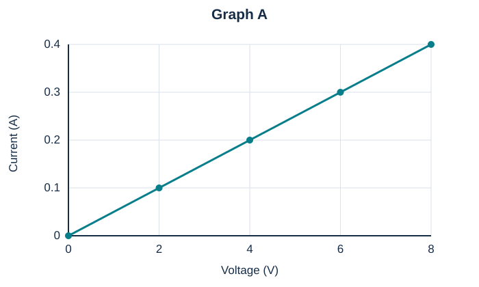

# Full Practice A

40 marks · suggested 45–55 minutes · original practice, not a school test.

Answer all questions. Use g = 9.8 N/kg where required. Give units. A calculator may be used for this practice version; your school’s calculator policy is unconfirmed. Single-choice and multiple-select instructions are stated per question.

### MC01 · Easy · 1 marks

Select the scientific definition of energy.

Select one answer.

- A. The ability to do work or cause change
- B. The force of gravity
- C. The speed of an object
- D. The mass of an object

### MC03 · Easy · 1 marks

Select all examples of stored potential energy.

Select all correct answers.

- A. A stretched spring
- B. Chemical energy in a battery
- C. A moving bicycle’s kinetic energy
- D. A book held above the floor

### MC05 · Medium · 1 marks

Predict the kinetic energy change when speed doubles and mass stays constant.

Select one answer.

- A. It doubles
- B. It quadruples
- C. It halves
- D. It stays constant

### MC09 · Medium · 1 marks

Select the clearest example of energy transfer between objects.

Select one answer.

- A. A battery’s chemical energy becomes electrical energy
- B. A lamp converts electrical energy to light
- C. A moving hand passes energy to a trolley it pushes
- D. A stretched band’s elastic energy becomes kinetic energy

### MC12 · Medium · 1 marks

Calculate the efficiency of a motor that receives 200 J and supplies 150 J of useful kinetic energy.

Select one answer.

- A. 25%
- B. 50%
- C. 75%
- D. 133%

### MC14 · Easy · 1 marks

Select all conditions needed for a sustained current in a simple battery-and-lamp metal-wire circuit.

Select all correct answers.

- A. An energy source
- B. A complete conducting loop
- C. A motor
- D. An open switch in the only path

### MC16 · Easy · 1 marks

Select the most precise definition of voltage between two points.

Select one answer.

- A. Charge passing per second
- B. Energy transferred per unit charge
- C. Total number of electrons in the wire
- D. Opposition to current

### MC19 · Medium · 1 marks

Predict the current change when resistance triples at constant voltage.

Select one answer.

- A. It triples
- B. It becomes one-third
- C. It becomes nine times larger
- D. It is unchanged

### MC23 · Easy · 1 marks

Select the voltage across each branch connected directly across an ideal 9 V supply.

Select one answer.

- A. 4.5 V regardless of branch number
- B. 9 V
- C. 18 V
- D. It must be zero

### MC29 · Medium · 1 marks

Select the most appropriate sequence for improving a prototype.

Select one answer.

- A. Build → test against criteria → evaluate → improve → retest
- B. Build → declare success → stop
- C. Change all features → ignore results
- D. Test once → choose the best-looking design

### SA01 · Easy · 2 marks

Convert 3.6 kJ to joules and explain your conversion.

### SA05 · Medium · 2 marks

Calculate the kinetic energy of a 500 g toy travelling at 4 m/s. Show the mass conversion.

### SA10 · Medium · 2 marks

Explain how decreasing mass and decreasing height both affect an object’s GPE near Earth.

### SA12 · Medium · 2 marks

Describe one energy transfer and one transformation when a bat strikes a ball and the ball rises.

### SA15 · Hard · 2 marks

Draw labelled energy bars for a system before and after release. Initially a spring stores 60 J and the car is stationary. Afterwards the spring is relaxed and 15 J has become thermal energy within the system. No energy crosses the system boundary.

### SA22 · Medium · 2 marks

Describe where to connect meters to measure the current through a lamp and voltage across that lamp.

### SA27 · Medium · 2 marks

Calculate resistance when a component has 9 V across it and a current of 0.03 A.

### SA29 · Hard · 2 marks

Use Graph A to find the resistance. Explain why the graph supports a constant-resistance model over the displayed range.

Accessible data/description: Graph A has voltage on the horizontal axis and current on the vertical axis; plotted points are (0 V,0 A), (2 V,0.1 A), (4 V,0.2 A), (6 V,0.3 A), (8 V,0.4 A).

| Voltage (V) | Current (A) |
| --- | --- |
| 0 | 0 |
| 2 | 0.1 |
| 4 | 0.2 |
| 6 | 0.3 |
| 8 | 0.4 |

### SA39 · Medium · 2 marks

Propose four stages for testing and improving two robot prototypes.

### ER01 · Hard · 6 marks

Two ball types are released from rest at the same centre-of-mass height of 100 cm above their contact reference levels onto the same hard surface. First-rebound heights are below.

| Ball type | Trial 1 (cm) | Trial 2 (cm) | Trial 3 (cm) |
| --- | --- | --- | --- |
| A | 72 | 74 | 73 |
| B | 58 | 62 | 60 |

- (a) Calculate the mean rebound height and rebound percentage for each type. [2 marks]
- (b) Explain the energy changes during one bounce and why rebound percentage is below 100%. [2 marks]
- (c) Propose two improvements that would strengthen this comparison, explaining each. [2 marks]

### ER07 · Hard · 6 marks

Two lamps are connected in separate parallel branches across an ideal 6 V source. Initially branch A carries 0.2 A and branch B carries 0.3 A. Each branch has its own switch.

- (a) Determine each lamp’s voltage and the total supply current when both switches are closed. [2 marks]
- (b) Predict what happens to branch A and the total current when branch B is switched off. [2 marks]
- (c) Compare this arrangement with a single series loop for independently controlled lights, giving one advantage and one trade-off. [2 marks]

