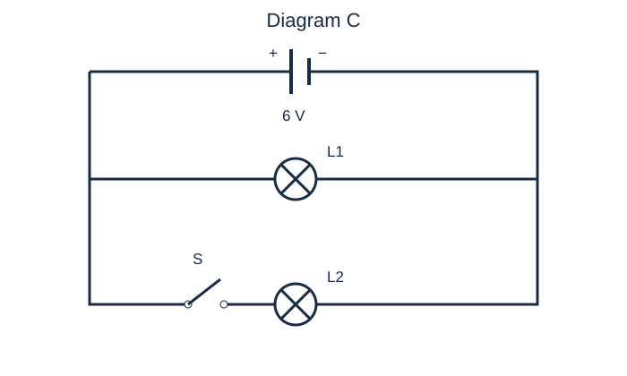
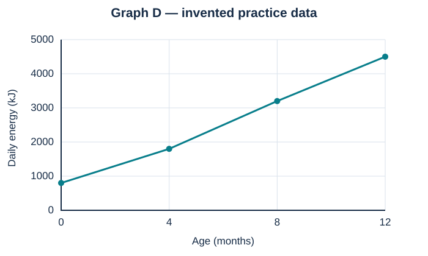

# Full Practice B

40 marks · suggested 45–55 minutes · original practice, not a school test.

Answer all questions. Use g = 9.8 N/kg where required. Give units. A calculator may be used for this practice version; your school’s calculator policy is unconfirmed. Single-choice and multiple-select instructions are stated per question.

### MC02 · Easy · 1 marks

Select the unit used for energy.

Select one answer.

- A. ampere (A)
- B. newton (N)
- C. joule (J)
- D. ohm (Ω)

### MC06 · Easy · 1 marks

Select the change that increases a book’s gravitational potential energy near Earth. Its mass is unchanged.

Select one answer.

- A. Move it to a lower shelf
- B. Move it sideways at the same height
- C. Move it to a higher shelf
- D. Leave it on its shelf

### MC08 · Easy · 1 marks

Select why an exercise band stores more elastic potential energy when stretched further within its elastic range.

Select one answer.

- A. Its mass must increase
- B. Its deformation increases
- C. It creates energy
- D. Gravity becomes stronger

### MC10 · Easy · 1 marks

Select the main useful energy transformation in a solar cell.

Select one answer.

- A. Light to electrical
- B. Electrical to chemical
- C. Sound to light
- D. Thermal to nuclear

### MC13 · Medium · 1 marks

Select the most justified conclusion when a passive ball is dropped from rest and rebounds to a lower height.

Select one answer.

- A. Energy has been destroyed
- B. Some initial mechanical energy has been transferred to other forms
- C. The ball has gained mass
- D. Gravity no longer acts during the rebound

### MC15 · Easy · 1 marks

Select the electron drift direction through the external metal wires of a battery circuit.

Select one answer.

- A. Positive to negative
- B. Negative to positive
- C. Both directions alternately in every battery circuit
- D. No electrons move

### MC18 · Easy · 1 marks

Select how to measure voltage across a resistor.

Select one answer.

- A. Place a voltmeter in series only
- B. Connect a voltmeter in parallel across its two ends
- C. Disconnect all wires and hold the meter nearby
- D. Connect an ammeter across it

### MC22 · Easy · 1 marks

Select the statement about a steady series circuit.

Select one answer.

- A. Current is used up by each lamp
- B. Current is the same through each component
- C. Every component always gets the full supply voltage
- D. There are several independent branches

### MC25 · Easy · 1 marks

Select the correct comparison.

Select one answer.

- A. DC periodically reverses; AC never reverses
- B. AC periodically reverses; DC flows in one direction
- C. Both must always reverse
- D. Both must have exactly 50 cycles per second

### MC11 · Medium · 1 marks

Select the best explanation of a sliding block slowing down on a rough floor.

Select one answer.

- A. Its energy disappears
- B. Some kinetic energy becomes thermal energy in the block and floor
- C. Its mass is converted entirely to sound
- D. Conservation of energy stops applying

### SA03 · Medium · 2 marks

Compare kinetic energy and gravitational potential energy using one similarity and one difference.

### SA07 · Hard · 2 marks

Determine how kinetic energy changes if mass doubles and speed halves. Explain without choosing particular values.

### SA09 · Medium · 2 marks

Calculate the GPE of a 0.4 kg ball at 75 cm above the chosen zero level. Use g = 9.8 N/kg.

### SA14 · Medium · 2 marks

Explain why a bicycle stopping does not contradict conservation of energy.

### SA17 · Medium · 2 marks

Calculate the rebound-height percentage for a ball dropped from 120 cm that rebounds to 84 cm.

### SA16 · Easy · 2 marks

Calculate the wasted energy and efficiency of a lamp receiving 500 J with 100 J of useful light output.

### SA28 · Medium · 2 marks

Explain what happens to current when resistance doubles at constant voltage. Use an equation and a numerical example.

### SA32 · Medium · 2 marks

Two parallel branches carry 0.2 A and 0.35 A. Determine the current in their common supply wire and explain.

### SA42 · Hard · 2 marks

Use Diagram C. Predict which lamps operate when switch S is open, and explain using the conducting paths. Assume an ideal source and intact lamps.

Accessible data/description: An ideal 6 V source connects two rails. L1 bridges the rails in one branch. A second branch bridges the rails through open switch S followed by L2.

### ER05 · Hard · 6 marks

Graph D shows an animal model’s daily energy requirement at four ages. The figures are invented practice data, not biological predictions.

Accessible data/description: Line graph of daily energy requirement in kJ against age in months; points (0,800), (4,1800), (8,3200), (12,4500).

| Age (months) | Daily energy (kJ) |
| --- | --- |
| 0 | 800 |
| 4 | 1800 |
| 8 | 3200 |
| 12 | 4500 |

- (a) Read the value at 8 months and convert it to joules per day. [2 marks]
- (b) Calculate the difference between 12 months and birth in joules per day. [2 marks]
- (c) Evaluate whether the graph justifies an exact prediction for 18 months, and explain how to improve the evidence. [2 marks]

### ER06 · Hard · 6 marks

A student measures an unknown resistor at several voltages while keeping its temperature approximately constant. Use the table.

| Voltage (V) | Current (A) |
| --- | --- |
| 2 | 0.1 |
| 4 | 0.2 |
| 6 | 0.3 |
| 8 | 0.4 |

- (a) Calculate resistance using two different rows. [2 marks]
- (b) Predict current at 10 V if the model remains valid, and justify the prediction. [2 marks]
- (c) Describe correct meter placement and one reason the resistance might not remain constant in a different experiment. [2 marks]

