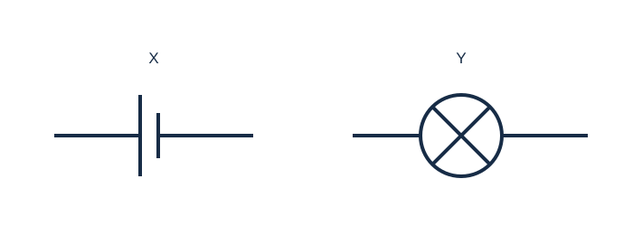

# Question bank

83 original practice questions. Answers are in Answer-Guide.md. Give units and show working. Multiple-select items use exact-set marking; no negative marks.

## Multiple choice

### MC01 · Easy · 1 marks

Select the scientific definition of energy.

Select one answer.

- A. The ability to do work or cause change
- B. The force of gravity
- C. The speed of an object
- D. The mass of an object

### MC02 · Easy · 1 marks

Select the unit used for energy.

Select one answer.

- A. ampere (A)
- B. newton (N)
- C. joule (J)
- D. ohm (Ω)

### MC03 · Easy · 1 marks

Select all examples of stored potential energy.

Select all correct answers.

- A. A stretched spring
- B. Chemical energy in a battery
- C. A moving bicycle’s kinetic energy
- D. A book held above the floor

### MC04 · Easy · 1 marks

Select the object with the greatest kinetic energy. All have mass 1 kg.

Select one answer.

- A. Stationary trolley
- B. Trolley at 2 m/s
- C. Trolley at 3 m/s
- D. Trolley at 4 m/s

### MC05 · Medium · 1 marks

Predict the kinetic energy change when speed doubles and mass stays constant.

Select one answer.

- A. It doubles
- B. It quadruples
- C. It halves
- D. It stays constant

### MC06 · Easy · 1 marks

Select the change that increases a book’s gravitational potential energy near Earth. Its mass is unchanged.

Select one answer.

- A. Move it to a lower shelf
- B. Move it sideways at the same height
- C. Move it to a higher shelf
- D. Leave it on its shelf

### MC07 · Medium · 1 marks

Select the object with the greatest gravitational potential energy. Heights use the same reference level.

Select one answer.

- A. 1 kg at 3 m
- B. 2 kg at 2 m
- C. 3 kg at 1 m
- D. 1 kg at 2 m

### MC08 · Easy · 1 marks

Select why an exercise band stores more elastic potential energy when stretched further within its elastic range.

Select one answer.

- A. Its mass must increase
- B. Its deformation increases
- C. It creates energy
- D. Gravity becomes stronger

### MC09 · Medium · 1 marks

Select the clearest example of energy transfer between objects.

Select one answer.

- A. A battery’s chemical energy becomes electrical energy
- B. A lamp converts electrical energy to light
- C. A moving hand passes energy to a trolley it pushes
- D. A stretched band’s elastic energy becomes kinetic energy

### MC10 · Easy · 1 marks

Select the main useful energy transformation in a solar cell.

Select one answer.

- A. Light to electrical
- B. Electrical to chemical
- C. Sound to light
- D. Thermal to nuclear

### MC11 · Medium · 1 marks

Select the best explanation of a sliding block slowing down on a rough floor.

Select one answer.

- A. Its energy disappears
- B. Some kinetic energy becomes thermal energy in the block and floor
- C. Its mass is converted entirely to sound
- D. Conservation of energy stops applying

### MC12 · Medium · 1 marks

Calculate the efficiency of a motor that receives 200 J and supplies 150 J of useful kinetic energy.

Select one answer.

- A. 25%
- B. 50%
- C. 75%
- D. 133%

### MC13 · Medium · 1 marks

Select the most justified conclusion when a passive ball is dropped from rest and rebounds to a lower height.

Select one answer.

- A. Energy has been destroyed
- B. Some initial mechanical energy has been transferred to other forms
- C. The ball has gained mass
- D. Gravity no longer acts during the rebound

### MC14 · Easy · 1 marks

Select all conditions needed for a sustained current in a simple battery-and-lamp metal-wire circuit.

Select all correct answers.

- A. An energy source
- B. A complete conducting loop
- C. A motor
- D. An open switch in the only path

### MC15 · Easy · 1 marks

Select the electron drift direction through the external metal wires of a battery circuit.

Select one answer.

- A. Positive to negative
- B. Negative to positive
- C. Both directions alternately in every battery circuit
- D. No electrons move

### MC16 · Easy · 1 marks

Select the most precise definition of voltage between two points.

Select one answer.

- A. Charge passing per second
- B. Energy transferred per unit charge
- C. Total number of electrons in the wire
- D. Opposition to current

### MC17 · Easy · 1 marks

Select how an ammeter measures current through a lamp.

Select one answer.

- A. In series with the lamp
- B. In parallel across the battery
- C. Disconnected beside the lamp
- D. Across the lamp in place of a voltmeter

### MC18 · Easy · 1 marks

Select how to measure voltage across a resistor.

Select one answer.

- A. Place a voltmeter in series only
- B. Connect a voltmeter in parallel across its two ends
- C. Disconnect all wires and hold the meter nearby
- D. Connect an ammeter across it

### MC19 · Medium · 1 marks

Predict the current change when resistance triples at constant voltage.

Select one answer.

- A. It triples
- B. It becomes one-third
- C. It becomes nine times larger
- D. It is unchanged

### MC20 · Easy · 1 marks

Calculate current for a circuit model with 6 V across a total resistance of 30 Ω.

Select one answer.

- A. 0.2 A
- B. 5 A
- C. 180 A
- D. 36 A

### MC21 · Medium · 1 marks

Calculate voltage across a 40 Ω resistor carrying 0.15 A.

Select one answer.

- A. 0.00375 V
- B. 6 V
- C. 40.15 V
- D. 266.7 V

### MC22 · Easy · 1 marks

Select the statement about a steady series circuit.

Select one answer.

- A. Current is used up by each lamp
- B. Current is the same through each component
- C. Every component always gets the full supply voltage
- D. There are several independent branches

### MC23 · Easy · 1 marks

Select the voltage across each branch connected directly across an ideal 9 V supply.

Select one answer.

- A. 4.5 V regardless of branch number
- B. 9 V
- C. 18 V
- D. It must be zero

### MC24 · Medium · 1 marks

Predict what happens if one lamp fails open in a two-branch parallel circuit with an ideal supply and otherwise intact wiring.

Select one answer.

- A. Both lamps must turn off
- B. The other branch can still operate
- C. The supply voltage must double
- D. Current must jump across the broken filament

### MC25 · Easy · 1 marks

Select the correct comparison.

Select one answer.

- A. DC periodically reverses; AC never reverses
- B. AC periodically reverses; DC flows in one direction
- C. Both must always reverse
- D. Both must have exactly 50 cycles per second

### MC26 · Medium · 1 marks

Select the best description of a short circuit.

Select one answer.

- A. Any circuit without a motor
- B. An unintended very low-resistance path bypassing part of a circuit
- C. A circuit drawn with short wires
- D. Any open switch

### MC27 · Medium · 1 marks

Select the best controlled comparison of ball type and rebound height.

Select one answer.

- A. Change ball type, drop height and floor each time
- B. Use the same drop height, floor and release method for each ball type
- C. Throw each ball with a different force
- D. Record only the best result for each ball

### MC28 · Medium · 1 marks

Select the main benefit of repeated trials under the same conditions.

Select one answer.

- A. They guarantee no systematic error
- B. They help reveal variation and improve the estimate of a typical result
- C. They replace the need for controlled variables
- D. They prove every theory

### MC29 · Medium · 1 marks

Select the most appropriate sequence for improving a prototype.

Select one answer.

- A. Build → test against criteria → evaluate → improve → retest
- B. Build → declare success → stop
- C. Change all features → ignore results
- D. Test once → choose the best-looking design

### MC30 · Hard · 1 marks

Select a valid final energy balance for an initially compressed spring with 80 J and a stationary car. No energy enters or leaves the spring-car system.

Select one answer.

- A. Car kinetic 100 J, other energy 0 J
- B. Car kinetic 60 J, thermal 20 J, spring elastic 0 J
- C. Car kinetic 80 J plus thermal 20 J
- D. All energy becomes zero

### MC31 · Easy · 1 marks

Select where nuclear energy is associated with matter.

Select one answer.

- A. The atom’s nucleus
- B. Only a stretched spring
- C. Only the height above a floor
- D. Only the motion of a bicycle

### MC32 · Medium · 1 marks

Select the best explanation of electrical heating in a metal resistor.

Select one answer.

- A. Charge is destroyed
- B. Energy is transferred to the material through interactions of charge carriers with the lattice
- C. Resistance creates energy from nothing
- D. Every increase in resistance always increases current

## Short answer

### SA01 · Easy · 2 marks

Convert 3.6 kJ to joules and explain your conversion.

### SA02 · Easy · 2 marks

Explain why a stationary book on a high shelf can have energy even though it has no kinetic energy relative to the room.

### SA03 · Medium · 2 marks

Compare kinetic energy and gravitational potential energy using one similarity and one difference.

### SA04 · Easy · 2 marks

Calculate the kinetic energy of a 4 kg cart travelling at 2 m/s. Show working.

### SA05 · Medium · 2 marks

Calculate the kinetic energy of a 500 g toy travelling at 4 m/s. Show the mass conversion.

### SA06 · Medium · 2 marks

Compare two carts: A has mass 2 kg and speed 3 m/s; B has mass 1 kg and speed 4 m/s. Which has more kinetic energy? Justify.

### SA07 · Hard · 2 marks

Determine how kinetic energy changes if mass doubles and speed halves. Explain without choosing particular values.

### SA08 · Easy · 2 marks

Calculate the gravitational potential energy gained when a 2 kg box is raised 1.5 m. Use g = 9.8 N/kg.

### SA09 · Medium · 2 marks

Calculate the GPE of a 0.4 kg ball at 75 cm above the chosen zero level. Use g = 9.8 N/kg.

### SA10 · Medium · 2 marks

Explain how decreasing mass and decreasing height both affect an object’s GPE near Earth.

### SA11 · Easy · 2 marks

Describe the energy changes as a ball compresses against a wall and then regains its shape.

### SA12 · Medium · 2 marks

Describe one energy transfer and one transformation when a bat strikes a ball and the ball rises.

### SA13 · Medium · 2 marks

Write the main energy-form chain for sunlight charging a battery that later powers a fan. Include the stored energy form.

### SA14 · Medium · 2 marks

Explain why a bicycle stopping does not contradict conservation of energy.

### SA15 · Hard · 2 marks

Draw labelled energy bars for a system before and after release. Initially a spring stores 60 J and the car is stationary. Afterwards the spring is relaxed and 15 J has become thermal energy within the system. No energy crosses the system boundary.

### SA16 · Easy · 2 marks

Calculate the wasted energy and efficiency of a lamp receiving 500 J with 100 J of useful light output.

### SA17 · Medium · 2 marks

Calculate the rebound-height percentage for a ball dropped from 120 cm that rebounds to 84 cm.

### SA18 · Hard · 2 marks

Explain when rebound height divided by drop height can estimate the fraction of GPE recovered after a bounce. Give two conditions.

### SA19 · Easy · 2 marks

Explain why a lamp in a simple series circuit turns off when its only switch opens.

### SA20 · Medium · 2 marks

Distinguish an open circuit from a short circuit.

### SA21 · Easy · 2 marks

Define current and voltage, including a unit for each.

### SA22 · Medium · 2 marks

Describe where to connect meters to measure the current through a lamp and voltage across that lamp.

### SA23 · Medium · 2 marks

Compare electron drift and conventional current directions in the external wires of a battery circuit.

### SA24 · Medium · 2 marks

Explain how a resistor can become warmer while electric charge is conserved.

### SA25 · Easy · 2 marks

Calculate current through a 24 Ω resistor with 12 V across it.

### SA26 · Medium · 2 marks

A student claims a 60 Ω resistor carrying 0.2 A needs 300 V because voltage is resistance divided by current. Evaluate the method and give the correct voltage.

### SA27 · Medium · 2 marks

Calculate resistance when a component has 9 V across it and a current of 0.03 A.

### SA28 · Medium · 2 marks

Explain what happens to current when resistance doubles at constant voltage. Use an equation and a numerical example.

### SA29 · Hard · 2 marks

Use Graph A to find the resistance. Explain why the graph supports a constant-resistance model over the displayed range.

Accessible data/description: Graph A has voltage on the horizontal axis and current on the vertical axis; plotted points are (0 V,0 A), (2 V,0.1 A), (4 V,0.2 A), (6 V,0.3 A), (8 V,0.4 A).

| Voltage (V) | Current (A) |
| --- | --- |
| 0 | 0 |
| 2 | 0.1 |
| 4 | 0.2 |
| 6 | 0.3 |
| 8 | 0.4 |

### SA30 · Easy · 2 marks

Explain why two lamps in a single series loop both go out if one filament breaks.

### SA31 · Medium · 2 marks

Two resistors are in series across an ideal 10 V supply. One has a voltage drop of 4 V. Determine the other voltage drop and state the rule used.

### SA32 · Medium · 2 marks

Two parallel branches carry 0.2 A and 0.35 A. Determine the current in their common supply wire and explain.

### SA33 · Medium · 2 marks

Explain why two parallel resistors can have equal voltage but different currents.

### SA34 · Medium · 2 marks

Explain what 50 Hz means for the Australian mains AC example in the notes, and distinguish cycles from reversals.

### SA35 · Medium · 2 marks

Identify the independent and dependent variables when testing how release height affects the first rebound height of one ball.

### SA36 · Medium · 2 marks

Propose two controls when investigating how release height affects the first rebound height of a ball, and explain why each matters.

### SA37 · Medium · 2 marks

Calculate the mean first rebound height for trials of 68, 72 and 70 cm. Describe the trial variation.

| Trial | Rebound height (cm) |
| --- | --- |
| 1 | 68 |
| 2 | 72 |
| 3 | 70 |

### SA38 · Hard · 2 marks

Evaluate the claim: “Our ruler starts 5 cm above the floor, but repeating the experiment ten times will remove that measurement error.”

### SA39 · Medium · 2 marks

Propose four stages for testing and improving two robot prototypes.

### SA40 · Hard · 2 marks

Evaluate using stopping distance to compare the kinetic energy delivered to the same toy car by two springs. State one condition and one limitation.

### SA41 · Easy · 2 marks

Identify symbols X and Y in Diagram B.

Accessible data/description: X: two unequal parallel vertical lines with wires; Y: a circle with a cross and wires.

### SA42 · Hard · 2 marks

Use Diagram C. Predict which lamps operate when switch S is open, and explain using the conducting paths. Assume an ideal source and intact lamps.

Accessible data/description: An ideal 6 V source connects two rails. L1 bridges the rails in one branch. A second branch bridges the rails through open switch S followed by L2.

## Extended responses

### ER01 · Hard · 6 marks

Two ball types are released from rest at the same centre-of-mass height of 100 cm above their contact reference levels onto the same hard surface. First-rebound heights are below.

| Ball type | Trial 1 (cm) | Trial 2 (cm) | Trial 3 (cm) |
| --- | --- | --- | --- |
| A | 72 | 74 | 73 |
| B | 58 | 62 | 60 |

- (a) Calculate the mean rebound height and rebound percentage for each type. [2 marks]
- (b) Explain the energy changes during one bounce and why rebound percentage is below 100%. [2 marks]
- (c) Propose two improvements that would strengthen this comparison, explaining each. [2 marks]

### ER02 · Hard · 6 marks

A spring initially stores 100 J. It launches a toy car. At a later instant the spring is relaxed, the car has 70 J of kinetic energy and the system has gained 30 J of thermal energy. No energy crosses the system boundary.

- (a) Describe a labelled energy-bar chart before and after release. [2 marks]
- (b) Explain whether the final measurements agree with conservation of energy. [2 marks]
- (c) A second design gives the same car 85 J of kinetic energy from 100 J input. Compare useful-output efficiencies and explain a possible improvement. [2 marks]

### ER03 · Hard · 6 marks

A solar-and-battery system powers a small reading lamp after sunset. A simplified charging event receives 800 J of sunlight and stores 200 J as chemical energy. During discharge, 50 J of that stored energy becomes useful lamp light; assume all other energy is transferred to the surroundings.

- (a) Describe the main energy-form chain from sunlight to lamp light. [2 marks]
- (b) Calculate the sunlight-to-storage efficiency and the overall sunlight-to-useful-light efficiency. [2 marks]
- (c) Describe two energy transfers between objects or places in this system, identifying the start and destination. [2 marks]

### ER04 · Hard · 6 marks

A 2 kg cart starts from rest 1.5 m above the bottom of a ramp. Take g = 9.8 N/kg. At the bottom, its kinetic energy is 20 J. No person pushes it.

- (a) Calculate the initial GPE and energy transferred to other forms by the bottom. [2 marks]
- (b) Explain the cart’s energy changes and calculate the percentage of initial GPE appearing as kinetic energy at the bottom. Round to one decimal place. [2 marks]
- (c) Evaluate the claim that doubling the starting height must double the bottom speed, even on an ideal frictionless ramp. [2 marks]

### ER05 · Hard · 6 marks

Graph D shows an animal model’s daily energy requirement at four ages. The figures are invented practice data, not biological predictions.

Accessible data/description: Line graph of daily energy requirement in kJ against age in months; points (0,800), (4,1800), (8,3200), (12,4500).

| Age (months) | Daily energy (kJ) |
| --- | --- |
| 0 | 800 |
| 4 | 1800 |
| 8 | 3200 |
| 12 | 4500 |

- (a) Read the value at 8 months and convert it to joules per day. [2 marks]
- (b) Calculate the difference between 12 months and birth in joules per day. [2 marks]
- (c) Evaluate whether the graph justifies an exact prediction for 18 months, and explain how to improve the evidence. [2 marks]

### ER06 · Hard · 6 marks

A student measures an unknown resistor at several voltages while keeping its temperature approximately constant. Use the table.

| Voltage (V) | Current (A) |
| --- | --- |
| 2 | 0.1 |
| 4 | 0.2 |
| 6 | 0.3 |
| 8 | 0.4 |

- (a) Calculate resistance using two different rows. [2 marks]
- (b) Predict current at 10 V if the model remains valid, and justify the prediction. [2 marks]
- (c) Describe correct meter placement and one reason the resistance might not remain constant in a different experiment. [2 marks]

### ER07 · Hard · 6 marks

Two lamps are connected in separate parallel branches across an ideal 6 V source. Initially branch A carries 0.2 A and branch B carries 0.3 A. Each branch has its own switch.

- (a) Determine each lamp’s voltage and the total supply current when both switches are closed. [2 marks]
- (b) Predict what happens to branch A and the total current when branch B is switched off. [2 marks]
- (c) Compare this arrangement with a single series loop for independently controlled lights, giving one advantage and one trade-off. [2 marks]

### ER08 · Hard · 6 marks

Two spring-powered vehicle prototypes must travel at least 1.2 m while staying in a 20 cm-wide lane. Prototype A travels 1.4, 1.3 and 1.5 m, but leaves the lane twice. B travels 1.2, 1.25 and 1.3 m and stays in the lane each time.

- (a) Evaluate which prototype better meets both criteria, using evidence. [2 marks]
- (b) Propose a fair comparison method that controls two relevant conditions. [2 marks]
- (c) Suggest one targeted improvement for A and describe how to check whether it works. [2 marks]

### ER09 · Hard · 6 marks

A student tests release height using one ball. At 50 cm they drop it onto carpet; at 100 cm they drop it onto wood; at 150 cm they throw it down onto wood. They do one trial at each height and conclude that height alone determines rebound.

- (a) Identify two changes besides height that weaken the conclusion. Explain each. [2 marks]
- (b) Design a better comparison, including repeated measurements and a consistent measurement reference. [2 marks]
- (c) Explain why a rebound above release height in the thrown trial would not disprove conservation of energy. [2 marks]

